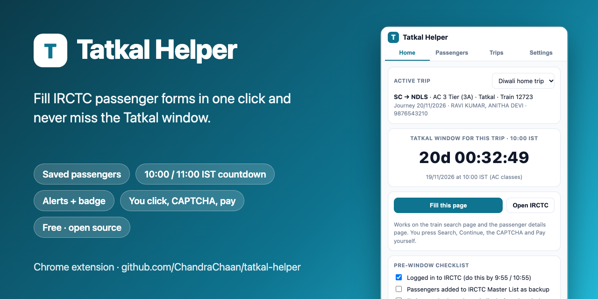
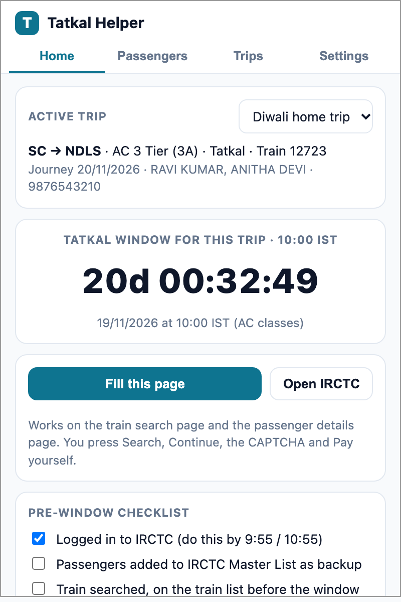
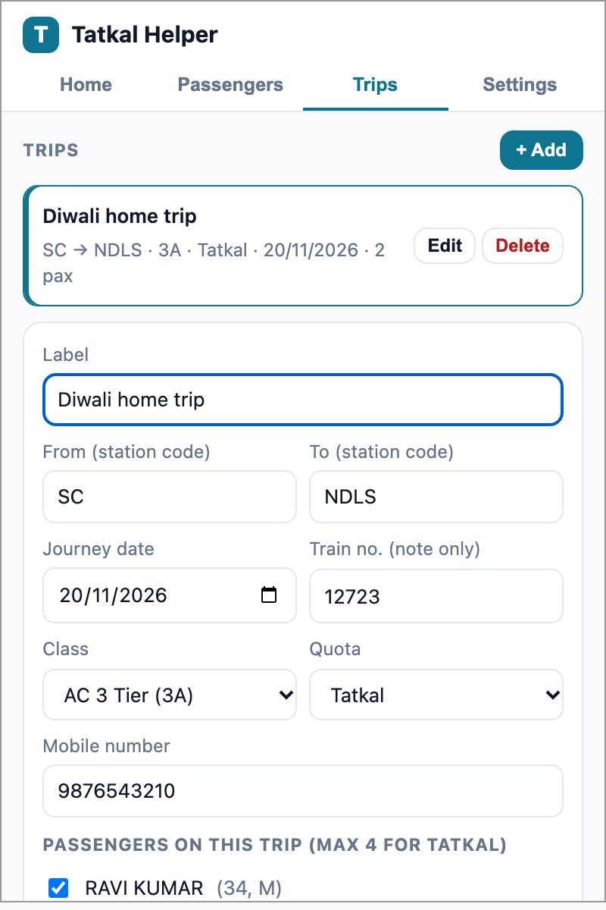
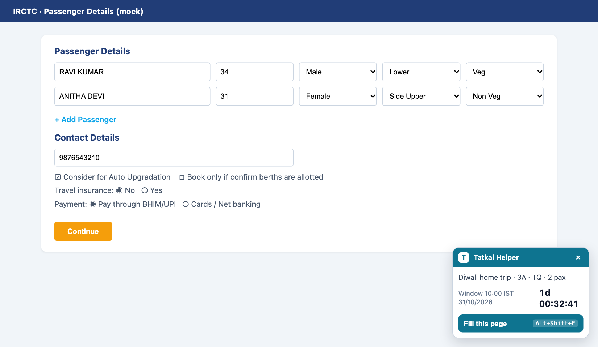

<p align="center">
  
</p>

<h1 align="center">Tatkal Helper</h1>

<p align="center">
  Free, open-source Chrome extension that fills IRCTC passenger forms in one click and counts down to the Tatkal window.<br>
  <strong>You still press every button.</strong> No auto-login, no auto-submit, no CAPTCHA tricks, no payment handling.
</p>

<p align="center">
  <a href="https://github.com/ChandraChaan/tatkal-helper/releases/latest"></a>
  <a href="https://github.com/ChandraChaan/tatkal-helper/releases"></a>
  <a href="LICENSE"></a>
  <a href="https://github.com/ChandraChaan/tatkal-helper/stargazers"></a>
  
</p>

<p align="center">
  <a href="https://github.com/ChandraChaan/tatkal-helper/releases/latest"><strong>⬇ Download</strong></a> ·
  <a href="#install-in-chrome-2-minutes">Install</a> ·
  <a href="#how-it-works">How it works</a> ·
  <a href="#booking-day-timeline">Booking day</a> ·
  <a href="#faq">FAQ</a> ·
  <a href="https://chandrachaan.github.io/tatkal-helper/">Website</a>
</p>

---

## Why this exists

Tatkal seats on popular trains are gone within a minute. Most of that minute is lost typing passenger names, ages and berth preferences, hunting for the mobile number field, and picking payment options. Tatkal Helper removes that typing: save your passengers once, and on booking day the passenger page fills itself in under a second. A countdown tells you exactly when the 10:00 (AC) or 11:00 (non-AC) IST window opens for your journey date, and Chrome notifies you before it does.

What it deliberately does **not** do is book for you. Bots get IRCTC accounts suspended and are illegal in India. This stays on the autofill side of that line.

## Screenshots

| Home: active trip, countdown, checklist | Trip editor | On the IRCTC page |
|---|---|---|
|  |  |  |

Dark mode follows your system theme.

## Features

- **Saved passengers**: name, age, gender, berth preference, food, optional ID. Reuse them on every trip.
- **Trips**: route, journey date, class, quota, mobile number, which passengers, and booking preferences (auto-upgrade, confirm-only, insurance, payment option).
- **One-click fill** on the IRCTC **train search** page (from, to, date, class, quota) and the **passenger details** page (adds rows, fills every passenger, mobile, preferences, pre-selects BHIM/UPI). Trigger it from the popup, the floating panel, or **Alt+Shift+F**.
- **Window countdown** in IST that knows the rule: Tatkal opens one day before the journey, 10:00 for AC classes and 11:00 for non-AC.
- **Alerts**: Chrome notifications at 10 and 2 minutes before (configurable), a toolbar badge with minutes remaining, and a green **GO** when it opens.
- **Pre-window checklist**, backup export/import, and no account or server. Everything stays in your browser.

## Install in Chrome (2 minutes)

1. Download **`tatkal-helper-x.y.z.zip`** from the [latest release](https://github.com/ChandraChaan/tatkal-helper/releases/latest).
2. Unzip it. You get a `tatkal-helper` folder. Keep it somewhere permanent; Chrome loads the extension from it.
3. Open `chrome://extensions` and turn on **Developer mode** (top right).
4. Click **Load unpacked** and choose the unzipped `tatkal-helper` folder.
5. Click the puzzle-piece icon and **pin** Tatkal Helper so the badge countdown stays visible.
6. Optional: at `chrome://extensions/shortcuts` confirm **Alt+Shift+F** is set.

Works the same way in Edge, Brave, Arc and other Chromium browsers. To update, unzip the new release over the same folder and press the reload icon on the extension card. Chrome may show "Disable developer mode extensions" at startup; dismiss it, the extension keeps working.

## How it works

1. **Set up once**, days before: add passengers, create a trip, pick the active trip. Also add the same passengers to IRCTC's own Master List as a backup.
2. **Booking day**: alerts fire, you log in, open the search page, press **Fill this page**, press **Search**. When the badge says GO you click your train and **Book Now**.
3. **Passenger page**: press **Fill this page** again. Review, press **Continue**, solve the CAPTCHA, approve the UPI request on your phone.

The fill logic sets values through the same browser events a keyboard does, so IRCTC's Angular forms see them as typed input. It targets IRCTC's form control names with placeholder and label fallbacks, and tells you in a toast exactly which field it could not set, so a layout change on IRCTC degrades to a partial fill rather than a silent failure.

## Booking day timeline

| When | You |
|---|---|
| T-10 min | Alert fires. Log in to IRCTC in one tab, close other IRCTC tabs. |
| T-5 min | Train search page: **Fill this page**, check the fields, **Search**. |
| T-1 min | On the train list with your train visible. UPI app unlocked on your phone. |
| T-0 | Badge shows **GO**. Click your class, then **Book Now**. |
| Passenger page | **Fill this page**. Review, **Continue**. |
| Review page | Solve the CAPTCHA, **Continue**. |
| Payment | Approve the UPI request. Done. |

## FAQ

**Does it book the ticket automatically?** No, and it never will. It fills form fields on pages you opened. You press Search, Book Now, Continue, the CAPTCHA and Pay. See the [legal note](#legal-note).

**Will IRCTC block my account?** IRCTC flags automated browsing (Selenium, Playwright, request bots). This extension does none of that; it behaves like a form autofill in your normal browser session. That said, IRCTC's terms discourage all helper tools, so use it at your own discretion.

**Is this faster than IRCTC's Master List?** Master List saves most of the typing already, and you should use it too. Tatkal Helper additionally fills the mobile number, preferences and payment option, fills the search page, and gives you the countdown, alerts and checklist. It also works when the Master List is slow to load at 10:00.

**Why no Chrome Web Store listing?** A store listing needs review and may be rejected because of IRCTC's stance on helper tools. Load unpacked takes two minutes and needs no account.

**Does it send my data anywhere?** No. There is no server, no analytics, no network calls. Data lives in `chrome.storage.local` on your machine. Export a backup from Settings.

**Something did not fill on the real IRCTC page.** The toast lists exactly which field. [Open an issue](https://github.com/ChandraChaan/tatkal-helper/issues/new?template=bug_report.yml) with that text and the rest still works meanwhile.

## Development

```bash
git clone https://github.com/ChandraChaan/tatkal-helper.git
cd tatkal-helper
python3 -m http.server 8765
# open http://localhost:8765/test/mock-irctc.html#auto  -> 43 checks run against a mock of the IRCTC pages
# open http://localhost:8765/test/popup-preview.html    -> popup with sample data
```

Load the repo folder itself with **Load unpacked** to run the development version.

| Path | What |
|---|---|
| `manifest.json` | Manifest V3; runs only on `https://www.irctc.co.in/*` |
| `content/fill-core.js` | Pure DOM fill logic for the search and passenger pages, no Chrome APIs, unit-tested on the mock page |
| `content/content.js` | Floating panel, countdown, message handling |
| `popup/` | Popup UI: Home, Passengers, Trips, Settings |
| `background.js` | Alarms, notifications, badge, keyboard shortcut |
| `shared/tatkal.js` | Class and quota lists, IST window maths |
| `test/` | Mock IRCTC pages and the automated checks |
| `scripts/build-zip.sh` | Packages a release zip; a `vX.Y.Z` tag publishes it through GitHub Actions |

Contributions welcome, see [CONTRIBUTING.md](CONTRIBUTING.md). The one hard rule: nothing that submits, logs in, solves CAPTCHAs or touches payment.

## Legal note

IRCTC's terms disallow automated booking tools and Indian Railways prosecutes bot-based Tatkal booking under the Railways Act. Tatkal Helper deliberately stays on the form-autofill side of that line: it fills fields on your screen, and you perform every navigation, submission, CAPTCHA and payment step yourself. Pull requests that add auto-submit, auto-login or CAPTCHA handling will not be merged. Not affiliated with IRCTC or Indian Railways.

## License

[MIT](LICENSE). If this saved you a Tatkal ticket, a ⭐ on the repo helps other travellers find it.
